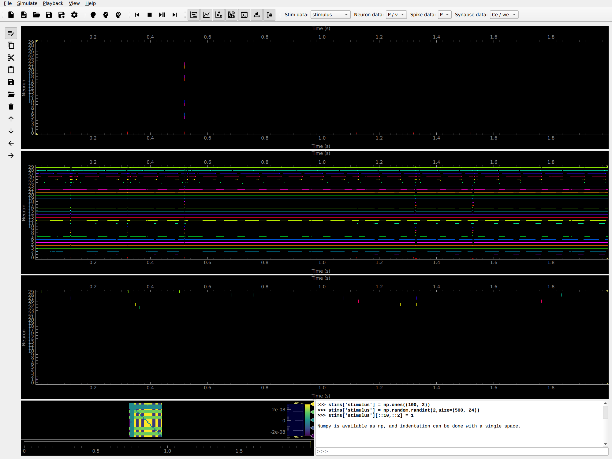

# Formozov Project

[](https://github.com/ssciwr/formozov-project/actions/workflows/ci.yml)

Private repository containing the prototype GUI for the [Formozov project](https://github.com/ssciwr/formozov-project-notes).



## Installation

If you have ssh authentication to GitHub set up you can install directly from this repository with pip:

```bash
pip install git+ssh://git@github.com/ssciwr/formozov-project
```

Alternatively you can clone the repository and then install it:

```bash
git clone git@github.com:ssciwr/formozov-project.git
cd formozov-project
pip install .
```

### How to install cython on Windows

To speed up simulations with cython on Windows one will need an installation of the Microsoft Visual C++ 14.0 or higher.

See for further instructions on installation: https://stackoverflow.com/questions/60322655/how-to-use-cython-on-windows-10-with-python-3-8

Visual Studio 2022 is available here: [https://learn.microsoft.com/en-us/visualstudio/releases/2022/release-notes#17.10.5](https://visualstudio.microsoft.com/)

## Use

After installing, you should be able to run the following command to launch the GUI:

```bash
formozov-project
```

## GUI Console

The GUI console is a text box at the bottom of the GUI that can be used to run Python code.
The code is executed in the same Python environment as the GUI, with the following variables made available:

- `np`: numpy
- `b2`: brian2
- `stims`: a dict of stimuli, each of which is a 2d numpy array
- `model`: a class that defines the entire model

The console also has a history feature, which can be accessed by pressing the up and down arrow keys.

### Stimuli editing

The main purpose of the console is to allow users to modify the numpy arrays of stimuli using numpy and Python code.
Any changes you make to the stimuli will be checked for validity, and if valid then they will updated in the model and the changes will be displayed in the GUI, e.g.

```python
>>> stims['stimulus'] = np.random.randint(2,size=(500, 24))
```

If the changes are invalid, then an error message will be displayed in the console, and the model will not be modified, e.g.

```python
>>> stims['stimulus'] = np.random.randint(2,size=(5, 5, 5))
    Invalid stims: expected dict[str, 1d or 2d numpy array], found dict with 3d numpy array for key 'stimulus'
```

### Model editing

It is also possible to modify other aspects of the model using the console, by interacting with the `model` object.
Try `help(model)` to see what methods and attributes are available.

### brian2 objects

The objects from the underlying brian2 model can also be accessed. For example, you can get a list of monitors with

```python
>>> model.monitors.keys()
dict_keys(['Traces_v', 'spikemon', 'synmon'])
```

And you can then get the underlying brian2 monitor object with e.g.

```python
>>> monitor = model.get_monitor('Traces_v')['object']
```

Note that these objects should not be directly modified using the console, as it will cause the GUI and `model` to become out of sync with the underlying brian2 model.

## Developer Installation

To do an editable installation including test dependencies and pre-commit:

```bash
git clone git@github.com:ssciwr/formozov-project.git
cd formozov-project
pip install -e .[tests]
pip install pre-commit
pre-commit install
```

The `-e` (editable install) flag used during installation means that any changes to the source code will be reflected in the installed package without needing to reinstall.

## Developer Use

The GUI is launched the same way as above:

```bash
formozov-project
```

To run the test suite:

```bash
pytest
```

By default this runs using xvfb to allow headless GUI testing. If you want to see the GUI while the tests are running, you can run:

```bash
pytest --no-xvfb
```
