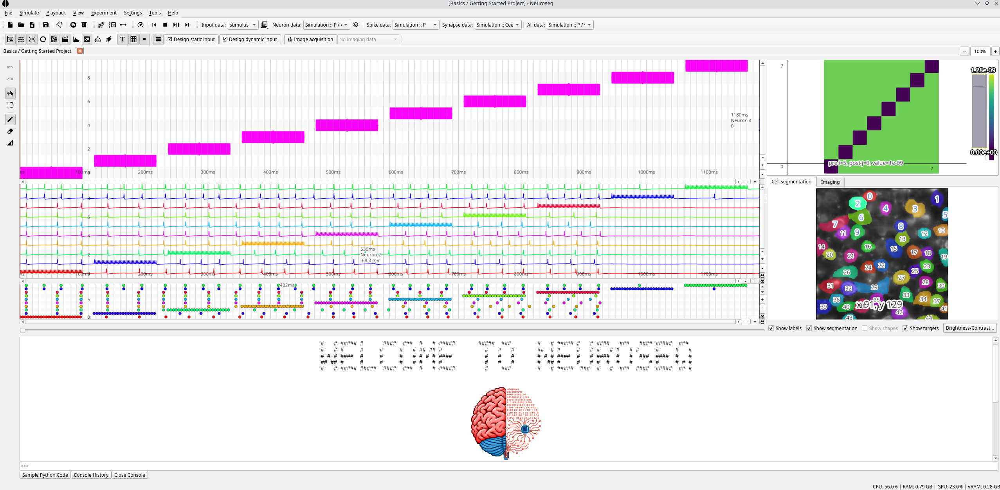

# NeuroSeq - Neuronal Sequencer

[](https://github.com/ssciwr/neuroseq/actions/workflows/ci.yml)

Private repository containing the neuroseq prototype GUI.



## Installation

### Conda

It is recommended to use Anaconda environment (package manager) for the installation. It can be downloaded from the [official webpage](https://www.anaconda.com/).

Once Anaconda installed, create and activate a new environment in a command line:

```
conda create -n neuroseq python=3.10
conda activate neuroseq
```

Alternatively, the new enviroment can be created within Anaconda Navigator. For this, open Anaconda Navigator and go to "Enviroments". Click "Create" button, write "neuroseq" as a name and select Python 3.10.

### Neuroseq

If you have ssh authentication to GitHub set up you can install directly from this repository with pip:

```bash
pip install git+ssh://git@github.com/ssciwr/neuroseq
```

Alternatively you can clone the repository and then install it:

```bash
git clone git@github.com:ssciwr/neuroseq.git
cd neuroseq
pip install .
```
### How to install Cython on Windows

To speed up brian2 simulations with Cython on Windows one will need an installation of the Microsoft Visual C++ version 14.0 or higher.

See this [stackoverflow post](https://stackoverflow.com/questions/60322655/how-to-use-cython-on-windows-10-with-python-3-8) for further instructions on installation: 

Visual Studio 2022 is available [here](https://learn.microsoft.com/en-us/visualstudio/releases/2022/release-notes#17.10.5)

## Use

After installing, you should be able to run the following command to launch the GUI:

```bash
neuroseq
```

## Documentation

Documentation for the project is availible [here](docs/index.md).

## Contributing and providing feed-back

The NeuroSeq is an open-source project. Everyone can suggest and implement improvements as well as improve overall reliability and stability of its operation.

To report a bug or suggest a new feature functionality please open a new issue. To implement a new feature, please fork the repository, modify the code accordingly and open a discussion with core developers via submitting a pull request.
