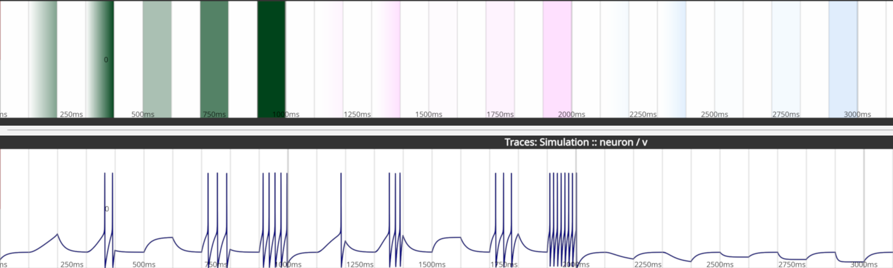

# Examples

Open examples with **File → Open example project** (each opens in a new tab).
Edit their parameters and initial conditions in **File → Edit Model**
(`Ctrl+E`).

## One input protocol, three substrates

| Substrate    | Run the input array                                                                                                                                      | Read out                                                                                                             |
| ------------ | -------------------------------------------------------------------------------------------------------------------------------------------------------- | -------------------------------------------------------------------------------------------------------------------- |
| Digital      | **Simulate → Run Simulation** (Brian2) or an [external simulator](networks/external_simulators.md)                                                       | traces, spikes and synapses appear in the panels                                                                     |
| Biological   | **Export → Optogenetic Input** or the **SysCon2 (HOLO4D)** tab of the Stimulation setup ([holographic stimulation](networks/holographic_stimulation.md)) | [ScanImage acquisition](networks/scanimage_acquisition.md), [imaging import](readout/imaging_data.md) or patch clamp |
| Neuromorphic | **BrainScaleS-2** tab of the Stimulation setup ([BrainScaleS-2](networks/brainscales2.md))                                                               | spikes and membrane traces read back                                                                                 |

For biological targets, map input rows to real cells with Cellpose
segmentation (**File → Cell segmentation**) first.

## Example projects

| Menu section  | Example                                                    | Contents                                                                                                                      |
| ------------- | ---------------------------------------------------------- | ----------------------------------------------------------------------------------------------------------------------------- |
| Basics        | Getting Started Project                                    | 10 HH neurons (8 exc, 2 inh) with a 2-photon FOV and mapped Cellpose cells ([Quickstart](getting_started/quickstart.md))      |
| Basics        | non_linear                                                 | two input neurons driving one neuron through non-linear synapses                                                              |
| Single Neuron | Hodgkin-Huxley Neuron                                      | patch clamp and optogenetics protocol (below)                                                                                 |
| Single Neuron | Adaptive Exponential Integrate-and-Fire Neuron             | regular-spiking AdEx (Brette and Gerstner 2005) with a current step                                                           |
| Single Neuron | Leaky-Integrate-and-Fire Neuron                            | LIF with `I_external` (pA) and opsin inputs in mW/mm²                                                                         |
| Network       | Network of Hodgkin-Huxley Neurons                          | Brian2 [COBAHH](https://brian2.readthedocs.io/en/stable/examples/COBAHH.html): 4000 neurons (80% exc), random 2% connectivity |
| Network       | Network of Hodgkin-Huxley Neurons with Predefined Synapses | same network, sparse (0.01%) fixed-weight connectivity                                                                        |
| Network       | Network of Hodgkin-Huxley Neurons with STDP                | two neurons (exc → inh) with a plastic synapse potentiated by pre-before-post pairing                                         |
| Network       | Two Hodgkin-Huxley Neurons with STDP                       | two excitatory neurons with an STDP pairing protocol                                                                          |
| Network       | Locally Connected Network                                  | 60-neuron 1-D network with Gaussian local excitation and surround inhibition                                                  |
| Network       | ELISE Sequence Learning Network                            | ELiSe sequence learning; needs the separate `elise` package                                                                   |
| Network       | Sinus Offset External Simulator                            | five sine-wave units through the external simulator interface                                                                 |
| Network       | PyNN AdEx Neuromorphic Network                             | AdEx network via PyNN (needs `pip install pyNN`); can target BrainScaleS-2                                                    |
| Optogenetics  | ChR2 in HEK293                                             | 10 cells with the PyRho 6-state ChR2 model                                                                                    |

## Hodgkin-Huxley Neuron

Models a whole-cell patch clamp recording of one neuron without synaptic input
(e.g. under synaptic blockers). Input arrays:

- `I_external` (pA, positive or negative): 100 ms ramps to ~300 and ~600 pA,
  then 100 ms steps of 200, 400 and 600 pA.
- `Exc_stimulation`, `Inh_stimulation` (fraction of the maximum opsin
  conductance): two 100 ms ramps (to ~50% and ~100%) and steps of 25, 50 and
  100%.

Opsins are ideal conductances with instant on/off: $E_{exc} = 0$ mV,
$E_{inh} = -80$ mV, $g_{exc} = g_{inh} = 0.1\ mS\,cm^{-2}$. There is no noise
input. Raising the neuron count adds independent copies. Setting the Na and K
conductances to zero models a non-neuronal cell.
