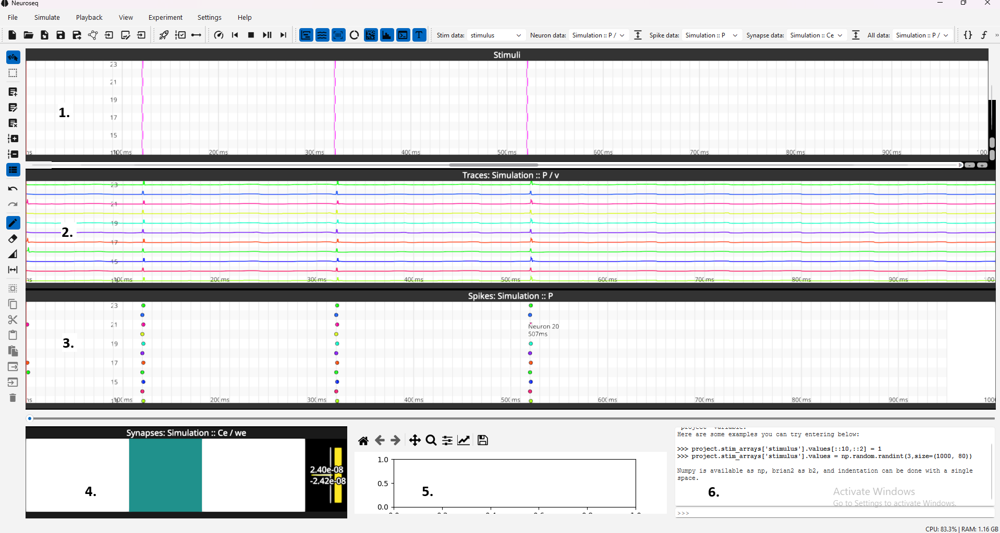
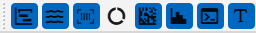
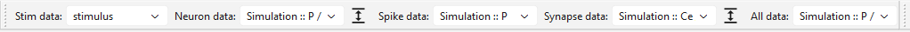
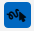
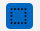
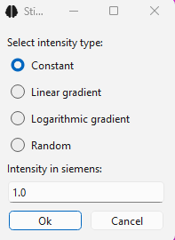
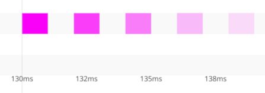

# GUI Overview

## Project tabs

Every open project lives in its own tab. `New`, `Open Project`, opening an
example project and dropping a `.nseq` file each open a new tab and leave the
other tabs untouched; closing a tab with unsaved changes asks whether to save
first. Menus and toolbars always act on the current tab. Only one simulation
can run at a time across all tabs (Brian2's random seed and code-generation
settings are shared), so starting a second one shows a notice instead.

## File menu

All data import and export actions are grouped under two sub-menus:

- `File → Import data`
  - `Input → Optogenetics` — SysCon2 `.seq` import (see [Multiphoton Holographic Stimulation](../Neural%20Networks/multiphoton_holographic_stimulation.md))
  - `Input → Patch Clamp` — Igor2 `.ibw` / `.pxp` or `.csv` / `.txt` input waveform import (see [Importing Igor2 Waves](../Input%20Design%20and%20Readout%20Analysis/importing_igor2_waves.md))
  - `Output → Calcium Imaging (raw .tif)` — raw 2-photon TIFF through the Cellpose + Suite2p pipeline
  - `Output → Calcium Imaging (Suite2p outputs)` — Suite2p fluorescence import
  - `Output → Patch Clamp` — patch-clamp recording (trace) import
- `File → Export`
  - `Patch Clamp Input` — Igor2 stimulus CSV/`.ibw`/`.pxp` export for SutterPatch (see [Export stimuli for patch clamp recordings](../Input%20Design%20and%20Readout%20Analysis/export_patch_clamp_stimuli.md))
  - `Optogenetic Input` — SysCon2 `.seq` (or Igor2) export for holographic hardware (see [Multiphoton Holographic Stimulation](../Neural%20Networks/multiphoton_holographic_stimulation.md)). This only writes files; to also import the sequence into a connected SysCon2, use **Export with settings…** in the Stimulation setup panel.
  - `Traces as NumPy Array…` / `Spikes as NumPy Array…` — save simulated or imported traces or spikes as a NumPy array with rows = neurons (by id) and columns = time points. Traces keep their own samples, at full resolution even for simulated traces, which plots downsample. Spikes are counted per time bin. The bin size defaults to the frame period of a trace in the same data group, else 1 ms, and the bins cover the data group's duration. A `.npy` file holds only the array; a `.npz` archive also holds `neuron_ids`, `times` (s) and `units`, with the array as `values`.

`File → Cell segmentation` imports or runs Cellpose segmentation, and
`File → Manage Data` lists the imported and simulated data groups so they can
be deleted.

### Undo and redo

Undo/redo covers input-array edits, deleting data groups in
`File → Manage Data`, and imports into the project. The history belongs to the
project tab and lasts for the session; it is not saved in the `.nseq` file.

### Dropping files

Files can also be dragged from the file explorer onto the NeuroSeq window.
Each opens its usual import dialog with the file already loaded, so the
imported data can be named and checked first:

| File                           | Dropped on                | Import                                     |
| ------------------------------ | ------------------------- | ------------------------------------------ |
| `.nseq`                        | anywhere                  | opens the project in a new tab             |
| `.seq`                         | anywhere                  | SysCon2 sequence as an input array         |
| `.ibw`, `.pxp`, `.csv`, `.txt` | the input array editor    | patch-clamp input wave                     |
| `.ibw`, `.pxp`, `.csv`, `.txt` | anywhere else             | patch-clamp traces                         |
| TIFF or PNG                    | the Cell segmentation tab | asks for the Cellpose model, then segments |
| TIFF                           | the traces                | calcium trace extraction (Suite2p or ROI)  |
| TIFF, GIF or movie             | the Imaging tab           | adds it as imaging data                    |
| TIFF, PNG, GIF or movie        | anywhere else             | asks which of the three imaging imports    |

## General Layout



The main layout of NeuroSeq consist of several widgets: the main widget for modification (drawing) of stimulation patterns (1), the widgets for visulisation of neuronal activity in form of traces (2) or spikes (3), monitor of synaptic connectivity (4). It also include a pad to quickly show some relevant analysis plots (5) and a GUI console (6).

The navigation in widgets (1-3) can be done with scrolling sliders or by holding a middle mouse button and moving the field of view of a given widget. By default, the field of new in all widgets is connected.

Zooming in and zooming out is done by corresponding "+" and "-" buttons or by holding "ctrl" or "shift" buttons and rotating mouse wheel for x- and y-axis, respectively.

Each widget can be shown or hidden in menu "View" by using the corresponding toolbar:



In addition to elements 1-6, the toolbar contains a universal widget that can dupicate widgets (2) and (3), useful for subsequent visulisation and data analysis. The button with capital "T" toggles and untoggles text annotation next to a mouse cursor — turn it off when the per-pixel coordinate label gets in the way of dense plots, and back on when you need it for precise selection.

**View → Show Stimulation setup** opens the stimulus-delivery pane, with one tab per target: **SysCon2 (HOLO4D)** for the holographic stimulation rig (see [Multiphoton Holographic Stimulation](../Neural%20Networks/multiphoton_holographic_stimulation.md)) and **BrainScaleS-2** for the neuromorphic chip (see [Deliver stimuli to BrainScaleS-2](../Neural%20Networks/brainscales2_delivery.md)).

**View → Toggle Grid** turns the time/neuron grid overlays on or off for the stim editor. The grid spacing follows the stim array's `dt`, so it doubles as a sample ruler.

### Saving and loading

`Open project` (`Ctrl+O`) and `Save project` (`Ctrl+S`) operate on `.nseq`
archives. Both run in a background worker thread, so the main window stays
responsive while large projects serialize. A progress dialog appears for any
operation that takes more than a fraction of a second and exposes a
**Cancel** button — cancelling a save leaves the original file untouched.

Once a project has been saved at least once, `Save project` (`Ctrl+S`) writes
straight back to that same file — no dialogs, everything included. Use
`Save project As...` to instead pick a new file (or different components to
include, via the save-options dialog) without touching the original file. A
brand-new, never-saved project always goes through `Save project As...`'s
dialogs the first time, regardless of which of the two actions triggered it.

The project may contrain not only one, but several stimulation arrays. The user can select which one to show in the widget one, using a drop down manu in the "Stim data:" section of the folloing toolbar:

.

Similarly, the trace, spike and synapce data may contain a list of different data entries (generated in computational, biologial or neuromorphic experiments) with corresponding drop down menues. "All data" corresponds to a universal widget where any data in a form of traces or spikes can be independently selected.

.

## Stimulation editor

The stimulatation pattern can be edited using the toolbar located at the left side of a main window. The editing can be operated in draw and select modes.





In the drawing mode, the user can switch between "draw stimulus" and "erise stimulus" regimes and choose the amplitude and duration of the a drawn stimuli. The amplitude of a stimulus can be constant, gradient and log-gradient and random.

.

Mouse can be used for drawing stimuli: left click is drawing and right click is erising. In erise mode, the functionality of the left and right buttons is inverted.
A longer stimulus can be drawing by holding a mouse button.

The intensity of stimulation is coded with transparency and normalized on the maximum value in an array. In the following example the relative ampitudes of stimuli are shown as 1 : 0.75 : 0.5 : 0.25 : 0.125 :

.

If "select mode" is active, the drawing options are not availible anymore, insteed other options are availible for selecting, copying, cutting, saving selected region and so on. The user can "do" and "undo" modifications in the editor using the corresponding buttons.

The toolbar also contains a pad with for creating/deleting new stim arrays, modifying the properties of the existing stimulation array (name, type, number of neurons and physical units) and padding/trimming the duration of an existing array.

The option "show all stim arrays" gives a possibility to show all stim arrays at the same time in one widget. In this case, the selected array remains the same, while other arrays will be shown in background with additional transparency applied.

## Neuron data and spike data widgets

Once the simulation is run or trace data is exported, it became availible in drop down menu "Neuron data". Natigation is done as described above. Normalization of traces can be set with buttons next it with a possibility to normalize traces on a median value and clip/upclip them to permit to restrict traces to the provided space for each neuron or provide a possibility to occupy an unlimited space within the widget. Spike data widget is analogous to the neuron data widget but constructed to represent binary spike events.

The data-selection toolbar has dedicated **Trace normalization** and
**Synapse normalization** buttons (vertical-double-arrow icons) that open
the per-widget normalization dialogs — median normalization, clip/unclip
range, and per-neuron scaling all live in those dialogs rather than in the
Settings menu.

## Cell spatial footprints

The **Cell segmentation** tab shows the imported Cellpose cells, labelled with
their neuron ids. With the mouse:

- **Left click** a cell to select it; the trace, input array and spike plots
  then show only the selected neurons. Click it again to deselect it.
- **Right drag** around cells to select several at once (lasso).
- **Double-click** empty space to clear the selection.
- **Right click** a cell to scroll the traces to its neuron. The vertical zoom
  stays the same and all other traces stay visible. A neuron whose trace is
  hidden by the current selection is not scrolled to.

## Synaptic data widget

The synaptic data widget contains the information about the states of synaptic connections in a given time point. Using the replay mechanism described below one can access the modifications of synapic changes.

For large networks the full synapse matrix can be too big to render in real
time. **Settings → Synapse matrix RAM limit** sets the memory budget (in
MB); when the matrix would exceed it, the widget transparently downsamples
along the time axis before rendering. The accompanying **Heatmap** widget
(toggled via **View → Show Heatmap**) gives a 2D heatmap view of the same
synaptic weight matrix.

## Universal widget

During analysis, it may be desirable to show an additional copy of the widget, for example, to compare two different periods or neuronal populations within the same widget and at the same time. For this a universal "all data" widget was constructed.

## Playback controls

The **Playback** menu (and its mirror in the toolbar) drives the time
cursor across every visualization widget simultaneously:

| Action             | Shortcut | Behaviour                                                     |
| ------------------ | -------- | ------------------------------------------------------------- |
| Set playback speed |          | Opens a dialog to choose a playback rate multiplier.          |
| Skip to start      |          | Jumps the cursor to t = 0 without affecting play/pause state. |
| Stop               |          | Pauses playback and rewinds the cursor to t = 0.              |
| Play / Pause       | `Space`  | Toggles continuous playback at the configured speed.          |
| Skip to end        |          | Jumps the cursor to the last simulated/recorded timepoint.    |

The time slider underneath the widgets stays clickable while playback is
running, so you can scrub manually at any time.

## Settings menu

The **Settings** menu groups preferences that affect the rest of the
application:

| Setting                   | What it does                                                                                                                                                |
| ------------------------- | ----------------------------------------------------------------------------------------------------------------------------------------------------------- |
| Brian2 simulation backend | Pick `cython` (default) or `numpy` (see [Simulations](../Neural%20Networks/simulations.md#choosing-a-brian2-backend)).                                      |
| Input automatic padding   | Default duration (seconds) used when creating new stim arrays and as a prefill for the _Pad stim array_ dialog.                                             |
| LLM assistant             | Configure provider, model, and API key for the [in-app chat assistant](chat_assistant.md) (experimental).                                                   |
| Synapse matrix RAM limit  | Memory budget for rendering the full synaptic weight matrix; controls when the synapse and heatmap widgets switch to downsampled mode.                      |
| Theme                     | Switch between a **Light**, **Dark** and **Retro light theme (beta)** (the default) appearance. The choice is remembered and re-applied on the next launch. |

The **Retro light theme (beta)** is the default on a fresh install. It is a
skin in the spirit of the classic Winamp light skins: brushed-metal chrome
with bevelled buttons, and dark LCD read-outs for the plot canvases, the
console and the status bar. It is still marked beta — some dialogs are less
polished than under the light and dark themes — and switching to **Light**
or **Dark** is remembered like any other theme choice.

## Analysis widget

The user can select a given region of the "neuron data" widget and access an analysis menu by right click of a mouse, and choosing a desired analysis plot/routine.
The result lands in the dedicated **Custom analysis** dock widget — toggled
from **View → Show Custom analysis** — or, with the `(new window)` variant
of the action, in a separate window. See
[Analysis Tools and Custom Plugins](../Input%20Design%20and%20Readout%20Analysis/analysis_and_plugins.md) for the full
list of built-in analyses and how to write your own plugin.

## GUI Console

The GUI console is a text box at the bottom of the GUI that can be used to run a custom Python code.

A **"Sample python code"** button sits directly below the console input box.
Clicking it opens a reference dialog with ready-to-use code snippets covering the most common tasks: listing and accessing stimulus arrays, editing values (zeroing, range assignment, generating waveforms), and accessing experiment and trace data.
All snippets can be selected and copied directly into the console input box.

The code is executed in the same Python environment as the GUI, with the following variables/objects made available (run dir() command to see the list):

- `np`: numpy
- `b2`: brian2
- `stims`: a dict of stimuli, each of which is a 2d numpy array
- `model`: a class that defines the entire model

The console also has a history feature, which can be accessed by pressing the up and down arrow keys.

### Stimuli Editing

One of the purposes of the console is to allow users to modify the numpy arrays of stimuli using numpy and Python code.
Any changes you make to the stimuli will be checked for validity, and if valid then they will be updated in the model and the changes will be displayed in the GUI, e.g.

```python
>>> stims['stimulus'] = np.random.randint(2,size=(500, 24))
```

Example for generating a simple sequential stimulation pattern:

```python
>>> for i in range(100):
...     project.stim_arrays['stimulus'].values[0+i*10:10+i*10,i] = 1
```

If the changes are invalid, then an error message will be displayed in the console, and the model will not be modified, e.g.

```python
>>> stims['stimulus'] = np.random.randint(2,size=(5, 5, 5))
    Invalid stims: expected dict[str, 1d or 2d numpy array], found dict with 3d numpy array for key 'stimulus'
```

### Model and brian2 objects

The objects from the underlying brian2 model can also be accessed. For example, you can get a list of monitors with

```python
>>> project.b2_model.monitors.keys()
dict_keys(['Traces_v', 'spikemon', 'synmon'])
```

And you can then get the underlying brian2 monitor object with e.g.

```python
>>> monitor = project.b2_model.get_monitor('Traces_v')['object']
```

Note that these objects should not be directly modified using the console, as it will cause the GUI and `model` to become out of sync with the underlying brian2 model.

It is also possible to modify other aspects of the model using the console, by interacting with the `project.b2_model` object.
Try `help(project.b2_model)` to see what methods and attributes are available.
