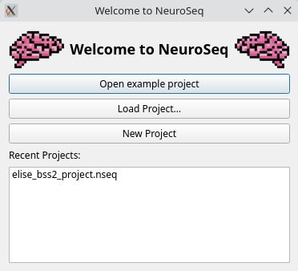

# Quickstart

1. Run `neuroseq`. In the **Welcome to NeuroSeq** dialog, click
   **Open example project**. This opens the _Getting Started Project_: a
   10-neuron Brian2 network with an input array and a 2-photon field of view
   whose Cellpose cells are mapped to the neurons.
2. Click **Simulate → Run Simulation** (rocket icon, `Ctrl+R`). The suggested
   duration is the length of the longest input array. Click **OK**.
3. Voltage traces and spikes appear in their panels when the run finishes.

The welcome dialog also offers **Load Project…**, **New Project** and recent
projects. More examples are under **File → Open example project**
(see [Examples](../examples.md)). Next: [GUI Overview](gui_overview.md).
