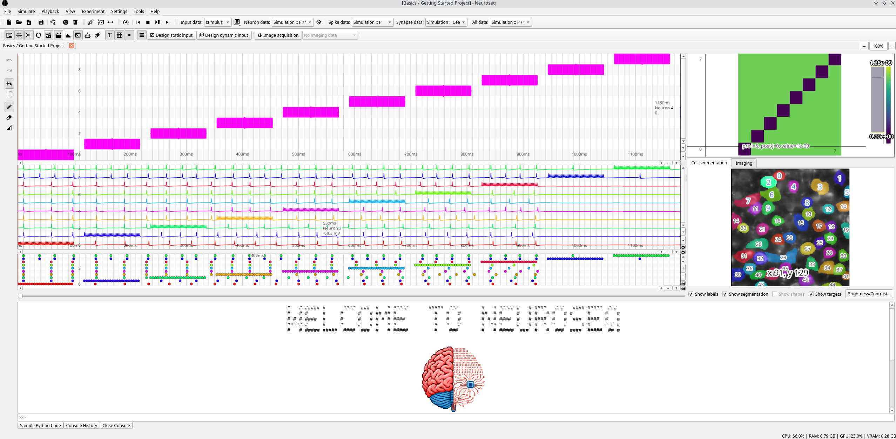

# Neuroseq

### Getting started

- [Installation](getting_started/installation.md)
- [Quickstart](getting_started/quickstart.md)

### User guide

- [GUI overview](user_guide/gui_overview.md)
- [Simulations](user_guide/simulations.md)
- [Experiments](user_guide/experiments.md)
- [Connecting simulations and experiments](user_guide/simulations_and_experiments.md)
- [Importing Imaging Data](user_guide/importing_imaging_data.md)
- [Multiphoton Holographic Stimulation](user_guide/multiphoton_holographic_stimulation.md)

### Examples

- [Examples](examples.md)

### Developer guide

- [Installation and use](developer/developer_installation.md)
- [Documentation](developer/documentation.md)
- [Miscellaneous](developer/miscellaneous.md)
- [Testing](developer/testing.md)
- [Contributing](developer/contributing.md)

### Troubleshooting

- [Common issues](common_issues.md)
