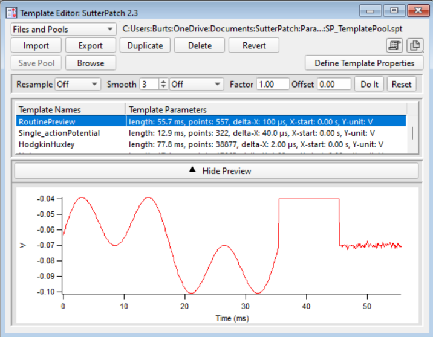

# Export input for patch clamp

**File → Export → Patch Clamp Input** writes input arrays for acquisition
software. First choose the format:

| Format                             | Exports                                                                                                                                                                                                                            |
| ---------------------------------- | ---------------------------------------------------------------------------------------------------------------------------------------------------------------------------------------------------------------------------------- |
| Igor2 - single array (.ibw / .csv) | One neuron of the array shown in the editor. Set **Neuron to export**, **Experiment name**, optional unit and scaling factor. The file type follows the save dialog (`.ibw` by default, or `.csv`). Inhibitory arrays are negated. |
| Igor2 - all arrays (.pxp)          | Selected input arrays as one Igor packed experiment, one wave per array. Inhibitory arrays are negated.                                                                                                                            |

**Export as sweeps (auto-detect period)** splits a repeating column into a
multi-sweep `.ibw` (one column per repeat); it is ignored for `.csv`. The
scaling factor accepts forms like `1e-12` or `2.5*10^(-12)`.

`.csv` is the most portable format; `.ibw` imports directly into Igor Pro.

## Loading a template in the amplifier software

SutterPatch runs Sutter amplifiers inside Igor Pro. Input waveforms are built in the
**Routine Editor**: one segment of type **Template** is enough.

1. Export the neuron's waveform as `.ibw` (or `.csv`).
2. In the **Template Editor**, click **Import** and pick the file.
3. The template then appears in the Routine Editor's template list.

To bring recordings back, see [Patch-clamp data](../readout/patch_clamp_data.md).
