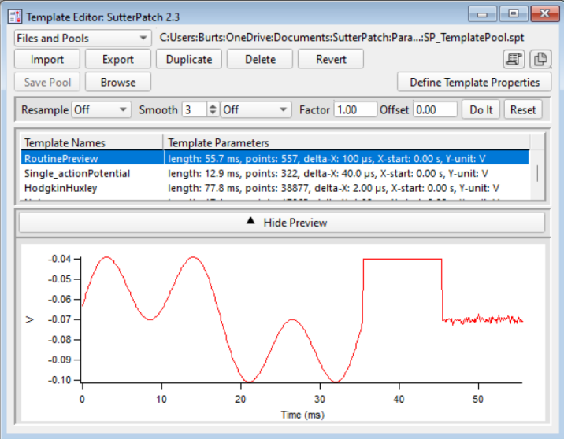

# Export stimuli for patch clamp recordings

A user can export stimuli from a given stimulation array to be used in patch clamp experiments. The most most universal format for export is *.csv supported by a large variety of 3rd party software.

The dialog for import can be found in "Experiment->Import patch clamp stimuli". The user can select an appropriate stimulation array from a drop down menu, indicate the index of a neuron that was patched and the desired file format (default is .csv file).

More specific data formats tailored to a given 3rd party software may be provide an advantage in automatization and speed up data transfer from Neuroseq to this software. Below, we consider a concreate example(s) of integration with currently availibe hardwave/software for patch clamp recordings.

## SutterPatch&reg;- Igor Pro&reg

The operation Sutter amplifiers is controlled via SutterPatch software run in the Igor Pro environment. 

The generation of stimuli in Igor Pro environment is controled in "Routine Editor". There, a single routine in the routine pool can be modified to represent a given sequence of stimulations composed from distinct segments. A user will need only a single segment setting in to "Template" as a type of stimuli. The *.csv file created by Neuroseq for SutterPatch can be imported in a form of a Template. 

The environment also has its own file format .ibw to store a stimuli of arbitraty shape. Neuroseq can directly generate the files of this format and facilitates import to SutterPatch. In this case, .ibw file with a sequence can be directly imported into  

