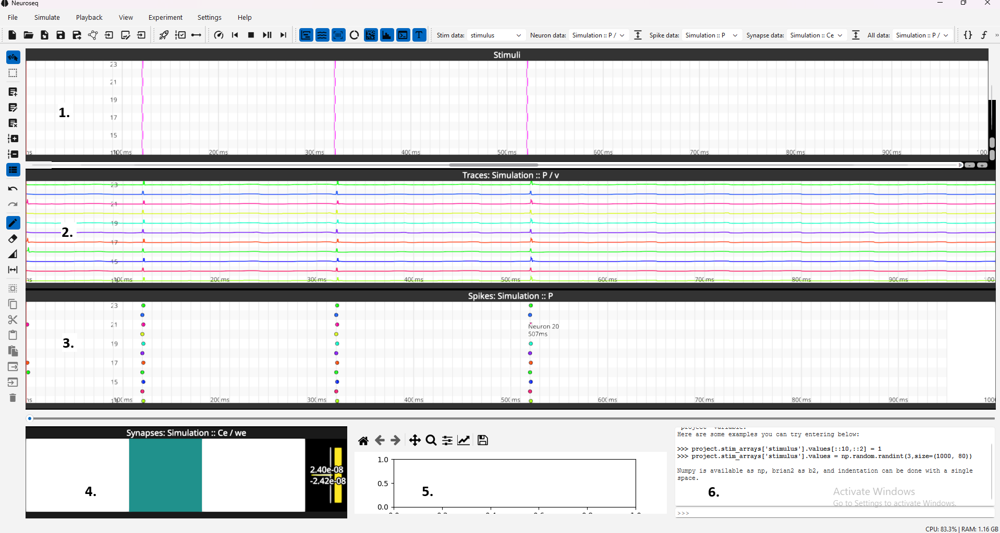
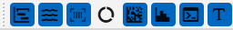
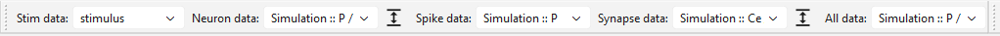

# GUI Overview

## General Layout



The main layout of NeuroSeq consist of several widgets: the main widget for modification (drawing) of stimulation patterns (1), the widgets for visulisation of neuronal activity in form of traces (2) or spikes (3), monitor of synaptic connectivity (4). It also include a pad to quickly show some relevant analysis plots (5) and a GUI console (6).

Each widget can be shown and hidden in menu "View" or using the corresponding toolbar:



In addition to elements 1-6, the toolbar also contains an additional, universal widget that can dupicate widget (2) or (3), useful for subsequent visulisation and data analysis. Addtionally, the button with capital "T" toggle and untoggle text annotation next to a mouse cursor.

The project may contrain not only one, but several stimulation arrays. The user can select which one to show in the widget one, using a drop down manu in the first section of the folloing toolbar:

.

Similarly, the trace, spike and synapce data may contain a list of different data entries (generated in computational, biologial or neuromorphic experiments) with corresponding drop down menues. "All data" correspond to universal widget where any data in a form of traces or spikes can be independently selected. Normalization of traces and synaptic monitors can be with buttons next to the corresponding drop down menues.

.

## GUI Console

The GUI console is a text box at the bottom of the GUI that can be used to run a custom Python code.

The code is executed in the same Python environment as the GUI, with the following variables/objects made available (run dir() command to see the list):

- `np`: numpy
- `b2`: brian2
- `stims`: a dict of stimuli, each of which is a 2d numpy array
- `model`: a class that defines the entire model

The console also has a history feature, which can be accessed by pressing the up and down arrow keys.

### Stimuli Editing

One of the purposes of the console is to allow users to modify the numpy arrays of stimuli using numpy and Python code.
Any changes you make to the stimuli will be checked for validity, and if valid then they will be updated in the model and the changes will be displayed in the GUI, e.g.

```python
>>> stims['stimulus'] = np.random.randint(2,size=(500, 24))
```

Example for generating a simple sequential stimulation pattern:

```python
>>> for i in range(100):
...     project.stim_arrays['stimulus'].values[0+i*10:10+i*10,i] = 1
```

If the changes are invalid, then an error message will be displayed in the console, and the model will not be modified, e.g.

```python
>>> stims['stimulus'] = np.random.randint(2,size=(5, 5, 5))
    Invalid stims: expected dict[str, 1d or 2d numpy array], found dict with 3d numpy array for key 'stimulus'
```

### Model editing

It is also possible to modify other aspects of the model using the console, by interacting with the `model` object.
Try `help(model)` to see what methods and attributes are available.

### brian2 objects

The objects from the underlying brian2 model can also be accessed. For example, you can get a list of monitors with

```python
>>> model.monitors.keys()
dict_keys(['Traces_v', 'spikemon', 'synmon'])
```

And you can then get the underlying brian2 monitor object with e.g.

```python
>>> monitor = model.get_monitor('Traces_v')['object']
```

Note that these objects should not be directly modified using the console, as it will cause the GUI and `model` to become out of sync with the underlying brian2 model.
